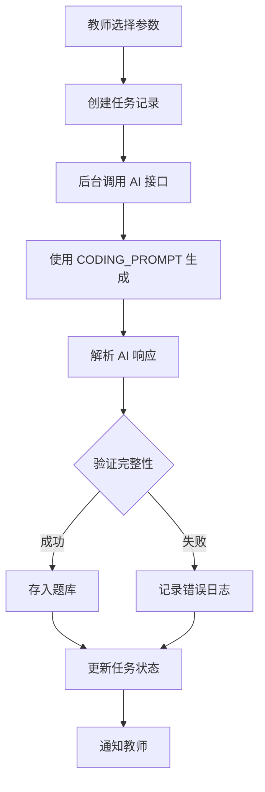

# 程序设计题目生成功能说明

## 📋 功能概述

**程序设计题目生成**（原"AI 出题"）功能允许教师使用 AI 技术自动生成编程实践题目。系统基于预设的 prompt 模板，根据选定的主题、难度和编程语言生成完整的编程题目，包括题目描述、参考答案和提示。

---

## 🎯 主要特性

### 1. 基于 Prompt 模板生成
- ✅ 使用优化的 [CODING_PROMPT](file:///Users/songhongtao/Downloads/code_exam_web/prompt_templates.py#L1-L58) 模板
- ✅ 包含详细的题目设计规范
- ✅ 确保生成内容的质量和一致性

### 2. 支持的 AI 模型
- **Ollama 本地模型**
  - Deepseek-Coder
  - Qwen-Coder
  - CodeLlama
  - deepseek-r1-32b
  - deepseek-r1-1.5b

- **DeepSeek API** (云端)
  - deepseek-chat 模型

### 3. 生成的内容

每道程序设计题目包含：

| 字段 | 说明 | 示例 |
|------|------|------|
| `topic` | 题目主题 | "文件处理" |
| `difficulty` | 难度等级 (1-3) | 2 |
| `language` | 编程语言 | "Python" |
| `question` | 详细题目描述 | 包含背景、输入输出、功能需求等 |
| `sample_answer` | 完整参考代码 | 含注释和错误处理 |
| `hints` | 3 条提示信息 | 语法要点、算法建议、常见错误 |

---

## 🔧 Prompt 模板详解

### CODING_PROMPT 结构

```python
CODING_PROMPT = """
### 角色设定
你是一名讲授{language}语言的专家，同时也是一位经验丰富的程序设计教师。

### 题目要求
**主题**: {topic}
**语言**: {language}
**难度级别**: {difficulty}/3

### 题目设计规范
1. 题目描述 (必须包含)
   - 清晰的问题背景和实际应用场景
   - 明确的输入输出要求
   - 至少 2-3 个具体功能需求
   - 至少 1 个边界条件或异常处理要求
   - 提供 1-2 个输入输出示例

2. 参考答案 (必须包含)
   - 完整、可运行的{language}代码
   - 良好的代码结构和命名规范
   - 关键逻辑的注释说明
   - 完善的错误处理机制

3. 提示 hints (必须包含 3 条)
   - 语法要点：涉及{language}的特定语法或特性
   - 算法建议：推荐的数据结构或算法思路
   - 常见错误：学生容易犯的典型错误

4. 难度控制
   - 难度 1：基础语法应用，单一知识点，代码量<50 行
   - 难度 2：综合应用，2-3 个知识点，代码量 50-100 行
   - 难度 3：复杂问题，多知识点综合，代码量 100-150 行

### 输出格式
请严格生成以下 JSON 格式...
"""
```

### 参数说明

| 参数 | 类型 | 说明 | 示例 |
|------|------|------|------|
| `{topic}` | string | 题目主题 | "DNA 序列分析" |
| `{language}` | string | 编程语言 | "Python" |
| `{difficulty}` | integer | 难度等级 (1-3) | 2 |

---

## 💻 使用方法

### 方法 1: 通过教师主页

1. **访问教师主页**
   ```
   http://localhost:5000/teacher/dashboard
   ```

2. **点击"程序设计题目生成"卡片**
   - 图标：💻
   - 描述：基于 AI 生成编程实践题目

3. **填写表单**
   - 选择主题（如：Python 数据分析）
   - 选择难度（1=简单，2=中等，3=困难）
   - 选择语言（Python/Java/R 等）
   - 设置题目数量
   - 选择 AI 模型

4. **提交生成任务**
   - 任务将在后台执行
   - 可在"后台任务"页面查看进度

5. **查看生成的题目**
   - 访问"题库审核"页面
   - 审核通过后进入正式题库

### 方法 2: 通过 API

```python
import requests

response = requests.post(
    'http://localhost:5000/teacher/generate_questions',
    data={
        'topic': '文件处理',
        'difficulty': 2,
        'language': 'Python',
        'count': 3,
        'ai_model': 'deepseek_API'
    }
)
```

---

## 📊 生成流程



---

## 🛠️ 代码实现

### 核心函数

#### 1. QuestionGenerator.generate_question()
```python
async def generate_question(self, topic: str, difficulty: int, 
                           language: str, aiModel: str) -> dict:
    """使用 Ollama 生成编程题目"""
    prompt = CODING_PROMPT.format(topic=topic, difficulty=difficulty, 
                                  language=language)
    
    # 调用 Ollama API
    response = await session.post(
        CONFIG["OLLAMA_ENDPOINT"],
        json={
            "model": aiModel,
            "prompt": prompt,
            "stream": False,
            "format": "json"
        }
    )
    
    return self._parse_response(data["response"])
```

#### 2. QuestionGenerator.generate_question_deepseek_api()
```python
async def generate_question_deepseek_api(self, topic, difficulty, 
                                        language, aiModel):
    """使用 DeepSeek API 生成编程题目"""
    prompt = CODING_PROMPT.format(topic=topic, difficulty=difficulty, 
                                  language=language)
    
    # 调用 DeepSeek API
    response = await session.post(
        CONFIG["DEEPSEEK_ENDPOINT"],
        headers=headers,
        json=payload
    )
    
    return self._parse_response(content)
```

### 后端路由

```python
@app.route('/teacher/generate_questions')
def teacher_generate_questions():
    """程序设计题目生成入口"""
    if request.method == 'POST':
        # 获取表单参数
        topic = request.form['topic']
        difficulty = int(request.form['difficulty'])
        language = request.form['language']
        count = int(request.form['count'])
        ai_model = request.form['ai_model']
        
        # 创建后台任务
        # ...
```

---

## ✅ 质量控制

### AI 响应验证

系统在多个层面进行质量检查：

1. **JSON 解析验证**
   ```python
   try:
       response_data = json.loads(raw_response)
   except JSONDecodeError:
       return {"error": "Invalid JSON"}
   ```

2. **必需字段检查**
   ```python
   required_fields = ['question', 'sample_answer', 'hints']
   for field in required_fields:
       if field not in response_data:
           return {"error": f"Missing field: {field}"}
   ```

3. **hints 字段增强**
   ```python
   if not isinstance(response_data.get('hints'), list):
       response_data['hints'] = []
   if len(response_data['hints']) == 0:
       response_data['hints'].append("请参考示例代码结构")
   ```

### 重试机制

```python
max_retries = 3
for attempt in range(max_retries):
    try:
        # 尝试调用 API
        return response_data
    except Exception as e:
        if attempt < max_retries - 1:
            await asyncio.sleep(5)  # 等待后重试
        else:
            raise Exception(f"生成失败：{str(e)}")
```

---

## 📝 最佳实践

### 1. 选择合适的难度

| 难度 | 适用场景 | 预期代码量 |
|------|---------|-----------|
| 1 | 初学者、基础语法练习 | <50 行 |
| 2 | 中级学员、综合应用 | 50-100 行 |
| 3 | 高级挑战、项目实战 | 100-150 行 |

### 2. 指定明确的主题

✅ **好的主题示例：**
- "DNA 序列 GC 含量计算"
- "FASTA 文件解析与统计"
- "蛋白质分子量计算器"

❌ **不好的主题示例：**
- "编程练习" （太宽泛）
- "数据处理" （不具体）

### 3. 合理设置题目数量

- **单次生成**: 建议 1-5 题
- **批量生成**: 最多 10 题（可能需要较长时间）

### 4. 选择合适的 AI 模型

| 模型 | 特点 | 适用场景 |
|------|------|---------|
| DeepSeek API | 质量高、速度快 | 正式考试题目 |
| deepseek-r1-32b | 本地运行、隐私好 | 日常练习 |
| Qwen-Coder | 代码能力强 | 算法题目 |

---

## 🔍 故障排查

### 常见问题

#### 1. 生成失败："Invalid JSON"
**原因**: AI 返回的格式不正确  
**解决**: 系统会自动重试，如仍失败请更换 AI 模型

#### 2. 提示缺失或不完整
**原因**: AI 没有遵循 prompt 要求  
**解决**: 系统会自动补充默认提示

#### 3. 代码无法运行
**原因**: AI 生成的代码可能有语法错误  
**解决**: 人工审核时测试代码

#### 4. Ollama 连接失败
**原因**: Ollama 服务未启动  
**解决**: 
```bash
# 启动 Ollama 服务
ollama serve
```

---

## 📈 统计数据

系统会记录以下指标：

- ✅ 生成成功题目数量
- ⏳ 后台任务执行进度
- 📊 各主题题目分布
- 🎯 不同难度的题目比例

---

## 🎓 教学价值

### 对教师的帮助
1. **节省出题时间** - 从几小时缩短到几分钟
2. **保证题目质量** - 基于最佳实践模板
3. **丰富题库资源** - 快速生成大量题目
4. **个性化定制** - 根据课程需求调整

### 对学生的好处
1. **多样化练习** - 每次练习都是新题目
2. **循序渐进** - 难度分级清晰
3. **即时反馈** - 参考答案详细完整
4. **提示引导** - 三个维度的学习支持

---

## 📞 技术支持

如有问题，请联系：
- 📧 系统管理员：songhongtao@bnu.edu.cn
- 📚 文档位置：`/app.py`, `/prompt_templates.py`

---

*最后更新：2026-03-18*  
*版本：v2.0 - 程序设计题目生成优化版*
